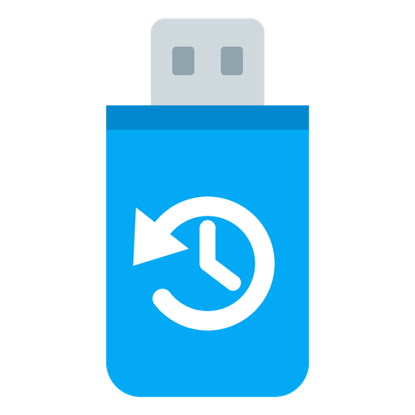

# HA: backup stick

**Backup Stick** is a custom integration for Home Assistant that adds a USB stick, plugged into the Home Assistant machine, as a backup location.

The stick shows up under *Settings → System → Backups* next to the backups kept on the machine itself. Home Assistant's own automatic backups, retention ("keep the last 7") and encryption all work with it. When the SD card or disk of the machine fails, the backups are still on the stick.

## How it works

- **Ordinary backup files:** backups are stored in a folder named `HomeAssistant-backups` on the stick, as normal Home Assistant backup files, each with a small metadata file. Nothing else on the stick is touched. To restore on a fresh install, copy the `.tar` file to a computer and upload it in Home Assistant.
- **Mounted only while in use:** the stick is mounted only for the moment a backup is written, read or listed, then flushed and unmounted. A power cut between backups can't damage it.
- **Stick missing:** the location reports an error and that copy is skipped. The backup on the machine itself still happens.

## Requirements

- **Home Assistant OS**, version 2026.10 or later. On other installation types, Home Assistant must run as root in a privileged container, so it can mount the stick.
- A USB stick formatted as **FAT32**, **exFAT** or **ext4**. Backups are typically tens to hundreds of MB each, so any stick of a few GB holds plenty.

## Installation

### With HACS

Or by hand:

1. In HACS, open the menu (⋮) → **Custom repositories**.
2. Add `https://github.com/SpuQ/HomeAssistant-BackupStick` with type **Integration**.
3. Find **Backup Stick** in HACS, download it, and restart Home Assistant.

### Manually

Copy `custom_components/backup_stick` into the `custom_components` folder of your Home Assistant configuration, then restart Home Assistant.

## Setup

1. Plug the stick into the Home Assistant machine.
2. Go to **Settings → Devices & services → Add integration** and choose **Backup Stick**, or use the button above. Pick the stick from the list. Disks that Home Assistant OS itself runs from are never offered.
3. Go to **Settings → System → Backups → Backup settings**, and tick the stick under **Locations**.

Save the **encryption key** Home Assistant shows in the backup settings. Backups on the stick are encrypted with it, and can't be restored without it.

## License

**Copyright 2026 Sanne 'SpuQ' Santens**. Backup Stick is licensed under the **[MIT License](LICENSE.txt)**.
